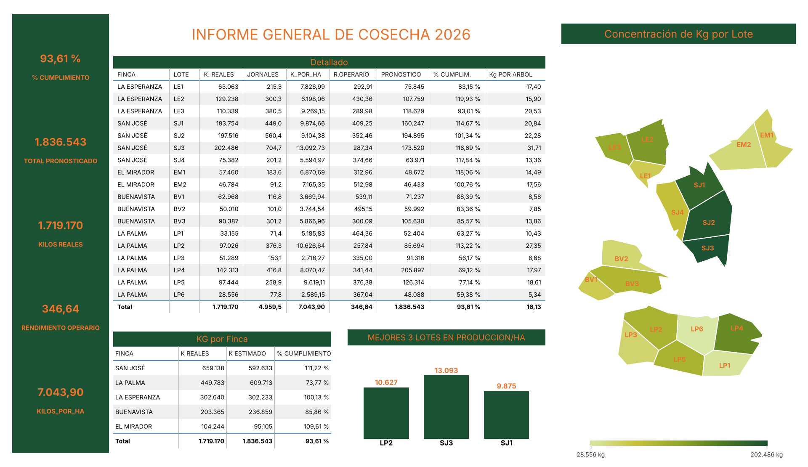
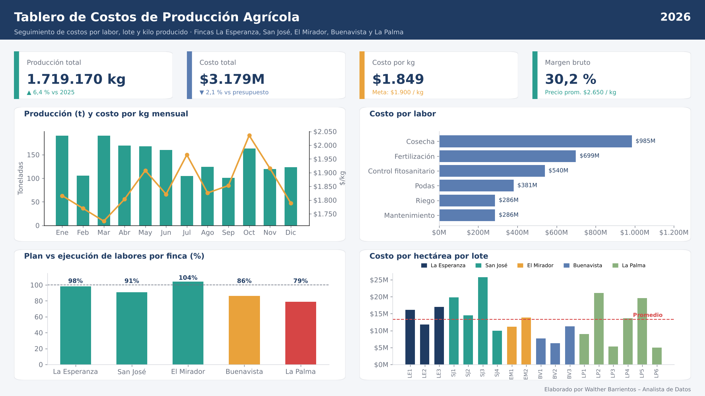
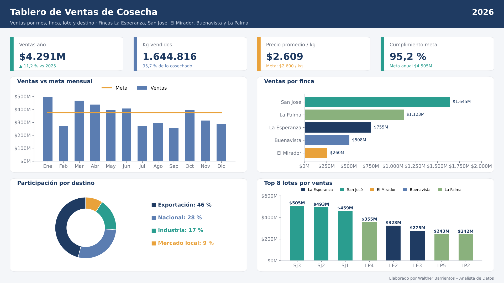
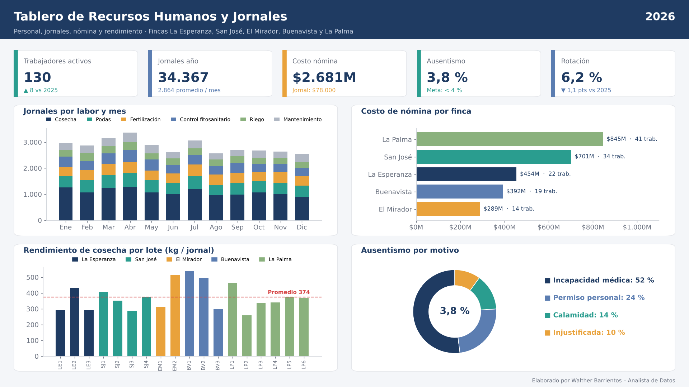
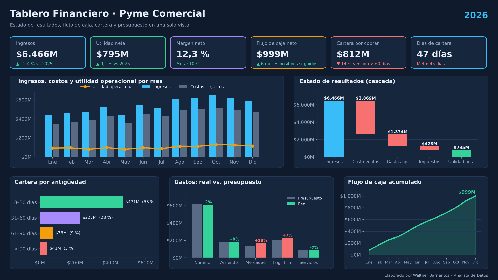

# Portafolio de Tableros de Análisis de Datos

Tableros de análisis de datos para el sector agrícola y para pymes, elaborados por **Walther Barrientos – Analista de Datos e Ingeniero de Software**.

Los cuatro tableros agrícolas comparten las mismas 5 fincas y 18 lotes:

| Finca | Lotes |
|---|---|
| La Esperanza | LE1 – LE3 |
| San José | SJ1 – SJ4 |
| El Mirador | EM1 – EM2 |
| Buenavista | BV1 – BV3 |
| La Palma | LP1 – LP6 |

## Tableros

### 1. Informe General de Cosecha
Kilos reales vs. pronosticados, % de cumplimiento, rendimiento por operario, kg por hectárea, kg por árbol, top 3 de lotes y mapa de concentración de kg por lote.



### 2. Costos de Producción Agrícola
Producción y costo por kg mensual, costo por labor, plan vs. ejecución por finca y costo por hectárea por lote.



### 3. Ventas de Cosecha
Ventas vs. meta, ventas por finca, precio promedio por kg, participación por destino y top de lotes.



### 4. Recursos Humanos y Jornales
Trabajadores, jornales por labor, costo de nómina por finca, rendimiento kg/jornal por lote y ausentismo.



### 5. Tablero Financiero para Pymes
Ingresos, utilidad neta y margen, estado de resultados en cascada, flujo de caja acumulado, cartera por antigüedad y gastos reales vs. presupuesto.



## Cómo ejecutarlo

```bash
pip install -r requirements.txt
python informe_cosecha.py      # genera el informe y los datos base de los lotes
python costos_y_ventas.py      # tableros de costos y ventas
python rrhh_jornales.py        # tablero de RRHH
python tablero_financiero.py   # tablero financiero
```

## Herramientas
Python (pandas, numpy, matplotlib, shapely) · Power BI · Excel · SQL

## Contacto
Disponible para proyectos de análisis de datos, tableros en Power BI y automatización con Excel/Python en Workana.
